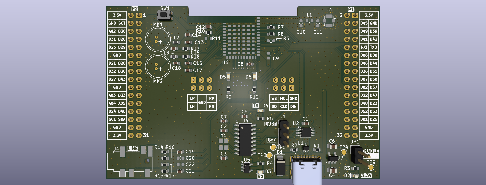
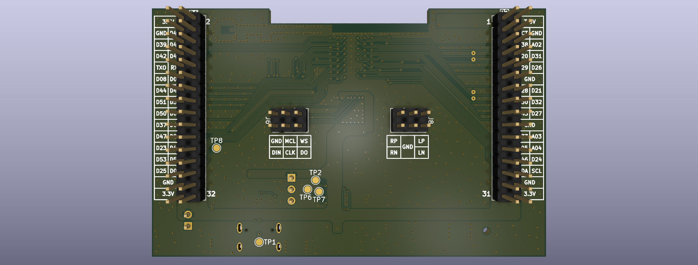
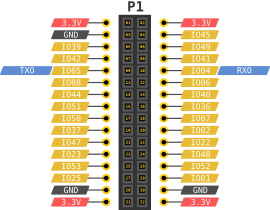
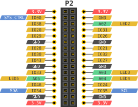
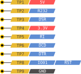

# Feasycom FSC-BT1104QI Breakout Board

An open-hardware breakout board designed for the Feasycom FSC-BT1104QI Bluetooth 5.4 dual-mode audio module.

This breakout board exposes the complete feature set and physical interface of the FSC-BT1104QI module. Rather than targeting standard breadboard layouts, the dual 32-pin header design breaks out all available module pins, making it an ideal core for integration into custom target boards, carrier systems, etc.

---

## Board Overview

### Front & Back Renders

| Board Front Layout | Board Rear Header Map |
| :---: | :---: |
|  |  |

---

## Key Hardware Features

- **Bluetooth Core**: Feasycom FSC-BT1104QI module supporting Bluetooth v5.4 dual-mode (Classic Bluetooth + LE Audio), preloaded with ASCII AT command modem firmware.
- **System Integration Design**: Engineered to break out all pins for clean integration onto parent/carrier PCBs.
- **USB Connectivity & Switching**: USB Type-C connector with an onboard high-bandwidth USB multiplexer (`U1`) allowing selection between direct USB communication with the Bluetooth module or serial debugging via an onboard USB-to-UART bridge.
- **Power Management**: Onboard low-noise 3.3V 600mA LDO regulator (`U3`) powering the module and peripheral logic from USB 5V.
- **Audio Routing**:
  - **Digital Audio**: Dedicated 6-pin header (`J6`) for 24-bit I2S / PCM digital audio interfaces.
  - **Analog Audio**: Dedicated 6-pin differential speaker output header (`J8`), multi-channel differential line inputs, and dual electret microphone input circuits with LC filtering.
- **Diagnostics & Testing**: Dedicated test point array (`TP1`–`TP9`) for probing power rails, reset lines, and RS-232 / UART hardware handshaking signals.

---

## Integrated Circuits

| Component Ref | Part Number | Functional Description | Key Electrical & Operating Capabilities | Datasheet Link |
| :--- | :--- | :--- | :--- | :--- |
| **U5** | **FSC-BT1104QI** | Bluetooth 5.4 Dual-Mode Audio Module (Qualcomm QCC3095 architecture, 240 MHz DSP, LE Audio, Classic BT) | - **Bluetooth Standard**: Bluetooth v5.4 - **Supply Voltage**: 3.3V (VDD_IO: 1.8V/3.3V) - **Tx Power / Rx Sensitivity**: +10 dBm / -93 dBm - **Audio Codecs**: aptX, aptX HD, aptX Adaptive, AAC, LDAC - **Operating Temp**: -40°C to +85°C | [FSC-BT1104QI Datasheet](https://www.feasycom.com/product/fsc-bt1104qi/) |
| **U3** | **AP2112K-3.3** | CMOS Low Dropout (LDO) Linear Voltage Regulator | - **Input Voltage Range**: 2.5V to 6.0V - **Output Voltage**: 3.3V fixed (±1.5% accuracy) - **Max Output Current**: 600 mA - **Dropout Voltage**: 250 mV typical at 600 mA - **Features**: Enable control, current limit, thermal shutdown | [AP2112K-3.3 Datasheet](https://www.diodes.com/assets/Datasheets/AP2112.pdf) |
| **U4** | **CH340G** | USB to Serial / UART Interface Bridge Transceiver | - **USB Interface**: USB 2.0 Full-Speed compliant - **Baud Rates**: 50 bps to 2 Mbps - **Supply Voltage**: 3.3V or 5.0V operation - **Signals**: Full modem signals (RTS, CTS, DTR, DSR, RI, DCD) | [CH340G Datasheet](https://cdn.sparkfun.com/datasheets/Dev/Arduino/Other/CH340DS1.PDF) |
| **U1** | **TS3USB30EDGSR** | High-Speed USB 2.0 (480 Mbps) 1:2 Multiplexer / Switch | - **Supply Voltage Range**: 1.8V to 4.3V - **Bandwidth**: 900 MHz (-3 dB bandwidth) - **ON-State Resistance**: 4.5 Ω typical - **ESD Protection**: 8 kV HBM ESD performance | [TS3USB30EDGSR Datasheet](https://www.ti.com/product/TS3USB30E/part-details/TS3USB30EDGSR) |

---

## Pinout Definitions & Interface Maps

### 1. Right Header Connector `P1`

---

### 2. Left Header Connector `P2`

---

### 3. Digital Audio Header `J6` (I2S Connector)

---

### 4. Differential Speaker Header `J8`

---

### 5. Onboard Diagnostic Test Points (`TP1`–`TP9`)

---

## Jumpers & Configuration Switches

- **`J1` (`USB_SEL`)**:
  - **Bridge 1-2**: Route USB Type-C lines to **CH340G** USB-to-UART bridge.
  - **Bridge 2-3**: Route USB Type-C lines directly to the **FSC-BT1104QI** module.
- **`JP1` (`ENABLE`)**: Disconnect if feeding 3.3V from P1 or P2.
- **`SW1` (`POWER_ON` / `SYS_CTRL`)**: Momentary push button tied to `SYS_CTRL` (Pin 2 on FSC module) for powering on/off or waking the module from sleep modes.
